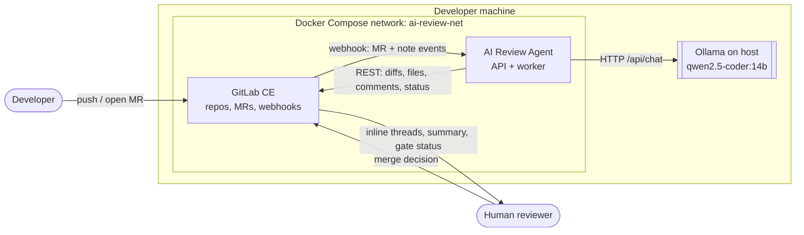
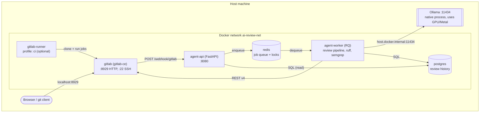
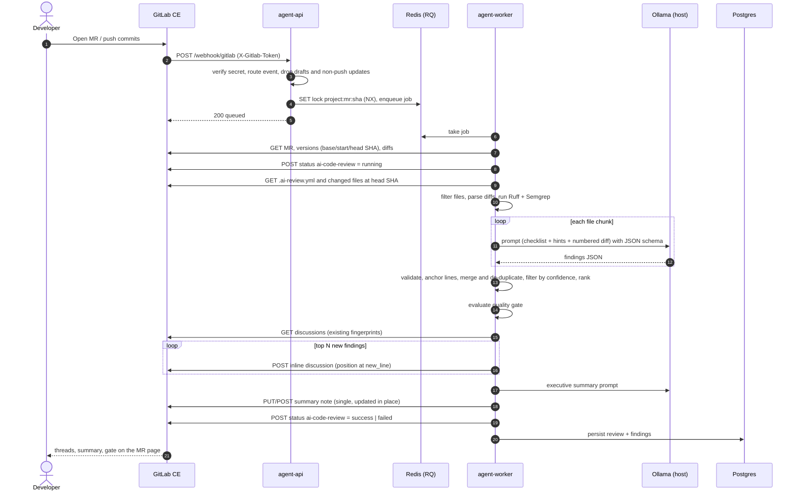
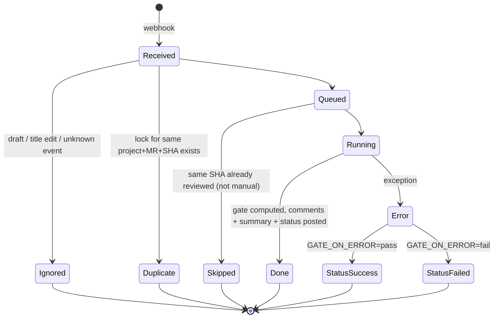
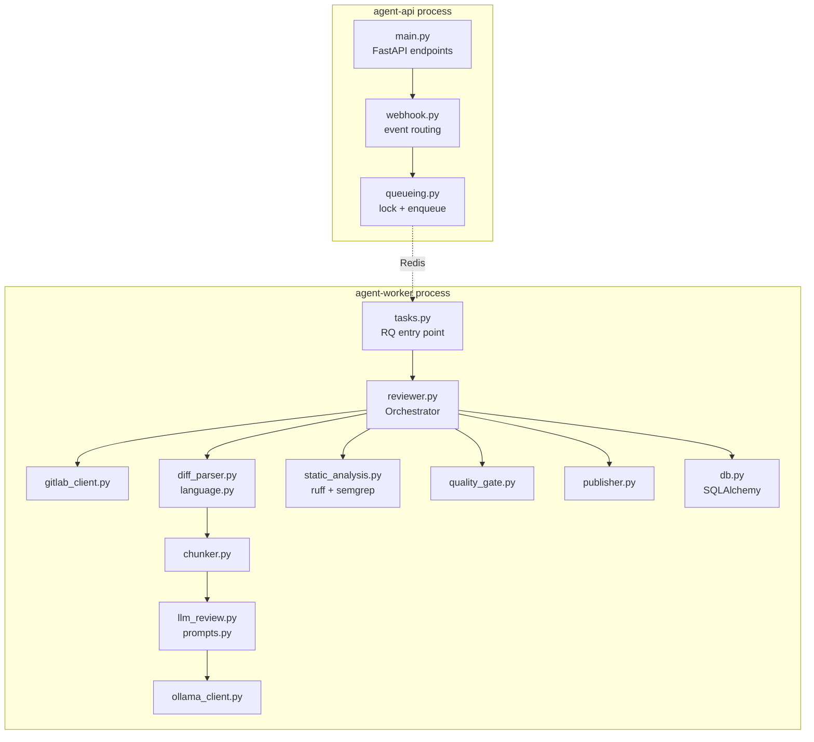
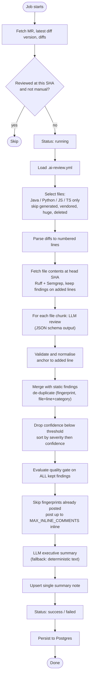
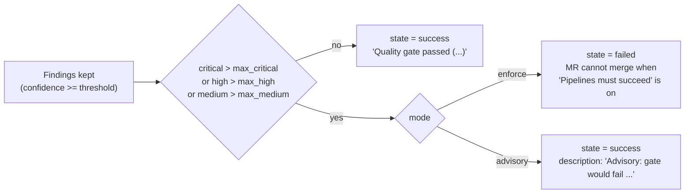
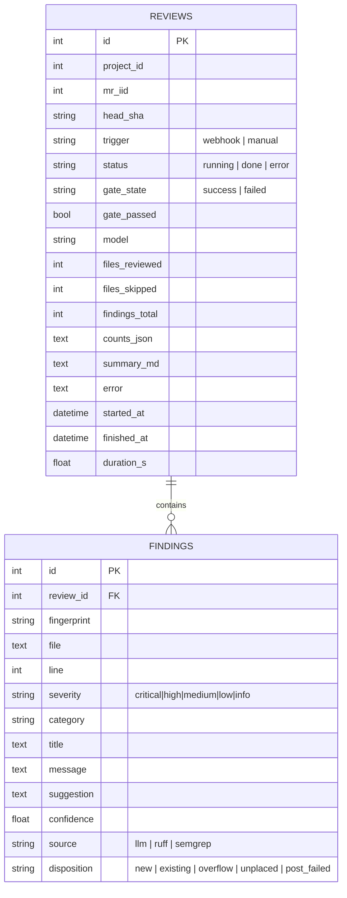
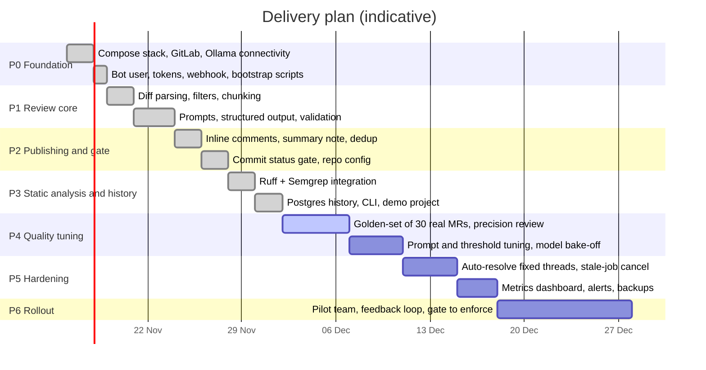

# GitLab CE AI Code Review Agent (Ollama · Python · Docker Compose)

A self-hosted AI reviewer for **GitLab Community Edition** merge requests. It runs entirely on your machine:
GitLab CE, the agent, Redis, Postgres and (optionally) a GitLab Runner run in Docker Compose, while the LLM runs
on the **host via Ollama**. No code leaves your laptop.

| | |
|---|---|
| **Languages reviewed** | Java, Python, JavaScript, TypeScript |
| **Review dimensions** | correctness, security, performance, concurrency, error handling, maintainability, readability, testing, API design, documentation, style, dependencies, observability |
| **Output** | inline discussion threads on the changed lines + one summary note + a quality-gate commit status |
| **LLM** | Ollama on the host, default `qwen2.5-coder:14b` |
| **Trigger** | GitLab webhook (MR opened / reopened / new commits) or a `/ai-review` comment |
| **Deterministic checks** | Ruff (Python) and Semgrep (Java/JS/TS/Python) feed the LLM and are also posted directly |

---

## Table of contents

1. [Quick start](#1-quick-start)
2. [Goals, non-goals and decisions](#2-goals-non-goals-and-decisions)
3. [High-level design](#3-high-level-design)
4. [Detailed design](#4-detailed-design)
5. [Quality gate](#5-quality-gate)
6. [Data model](#6-data-model)
7. [Configuration reference](#7-configuration-reference)
8. [Implementation plan](#8-implementation-plan)
9. [Testing strategy](#9-testing-strategy)
10. [Security and privacy](#10-security-and-privacy)
11. [Sizing and performance](#11-sizing-and-performance)
12. [Troubleshooting](#12-troubleshooting)
13. [Limitations and roadmap](#13-limitations-and-roadmap)
14. [Repository layout](#14-repository-layout)

---

## 1. Quick start

**Prerequisites:** Docker with Compose v2, [Ollama](https://ollama.com) on the host, `curl`, `openssl`, `make` (optional).
Recommended hardware: **32 GB RAM** for the 14B model plus GitLab. On 16 GB machines use `qwen2.5-coder:7b`
(set `OLLAMA_MODEL` in `.env`) and expect weaker reviews.

```bash
# 1. Ollama on the host
ollama pull qwen2.5-coder:14b
#    Linux only: containers reach the host through the Docker gateway, so Ollama must listen on all interfaces:
#    sudo systemctl edit ollama  ->  [Service] Environment="OLLAMA_HOST=0.0.0.0"   then restart ollama
#    (macOS / Windows Docker Desktop: nothing to change.)

# 2. Configure and start the stack
cp .env.example .env
docker compose up -d --build        # or: make up
#    GitLab needs 3-8 minutes on first boot.

# 3. One-time bootstrap: admin token, bot user "ai-reviewer", bot token, local webhooks allowed
./scripts/bootstrap.sh              # or: make bootstrap

# 4. Create a demo project + merge request full of deliberate flaws
make demo                           # = docker compose exec agent-api python -m app.cli demo

# 5. Watch the review happen
make logs                           # then open the MR URL printed by `make demo`
```

GitLab: <http://localhost:8929> (user `root`, password from `.env`, default `ReviewDemo2026Pass`).
Agent health: <http://localhost:8080/healthz>. Review history: <http://localhost:8080/api/reviews>.

**Use it on your own project**

```bash
docker compose exec agent-api python -m app.cli setup-project group/my-project
```

This adds the bot as *Developer*, creates the webhook (merge-request + comment events) and turns on
*Settings → Merge requests → "Pipelines must succeed"* so the quality gate can block merges.

**Re-run a review:** comment `/ai-review` on the merge request.

**Optional runner for project pipelines:** `make runner`, then copy `samples/gitlab-ci.example.yml` into your project.

> If `scripts/bootstrap.sh` fails at the admin-token step (the rails internals differ between GitLab versions), create
> a personal access token for `root` in the UI (scopes `api`, `create_runner`), put it into `.env` as
> `GITLAB_ADMIN_TOKEN`, and run `docker compose run --rm agent-api python -m app.cli bootstrap --print-env`;
> copy the printed `GITLAB_TOKEN=...` line into `.env`, then `docker compose up -d agent-api agent-worker`.

---

## 2. Goals, non-goals and decisions

**Goals**

- Fast, private, repeatable first-pass review on every MR, across all review dimensions.
- Feedback where developers look: inline threads, one summary, and a merge-blocking status.
- Runs on a developer laptop with a local model; every external dependency is replaceable.
- Idempotent and quiet: no duplicate comments on re-runs, bounded comment volume, confidence filtering.

**Non-goals (POC)**

- Replacing human review or architectural review.
- Whole-repository understanding (the agent reviews the diff plus project instructions; see roadmap).
- Auto-fixing code or pushing commits.

**Key decisions**

| # | Decision | Rationale | Trade-off |
|---|---|---|---|
| D1 | Webhook-triggered async worker (FastAPI → Redis/RQ → worker) | Webhooks must return in seconds; LLM reviews take minutes | Extra moving parts (Redis) |
| D2 | One **sequential** worker | A single local Ollama processes one request at a time; parallelism only adds queueing | Lower throughput |
| D3 | Ollama on the **host**, not in Compose | Uses the host GPU / Apple Silicon Metal directly; Docker GPU passthrough is painful | Linux needs `OLLAMA_HOST=0.0.0.0` |
| D4 | Structured output (JSON schema) + lenient parser | Small local models drift; schema + validation + dropping invalid items keeps the pipeline robust | Slightly slower decoding |
| D5 | Line-numbered diff in the prompt | Models cannot count lines; giving the real new-file number removes the biggest inline-comment failure mode | Larger prompts |
| D6 | Static analyzers run first, as hints and as findings | Deterministic, cheap, no hallucinations; frees the LLM for logic and design | Possible overlap (de-duplicated) |
| D7 | Fingerprint marker (`ai-review:fp=…`) hidden in each comment | Stateless de-duplication that survives DB resets; fingerprint = file + category + rule + anchored code text, so it is stable across line shifts | Edits to the anchored line produce a new finding |
| D8 | Quality gate = GitLab **commit status** `ai-code-review` + "Pipelines must succeed" | Works in **GitLab CE**; approval rules are an EE feature | Needs a pipeline object; the status creates an external one if none exists |
| D9 | Postgres for review history | Audit trail, metrics, tuning of prompts and thresholds | One more container |
| D10 | Fail-open on agent errors (`GATE_ON_ERROR=pass`) | A broken reviewer must not freeze delivery | Configurable to fail-closed |

---

## 3. High-level design

### 3.1 System context



### 3.2 Container / deployment view



### 3.3 End-to-end sequence



### 3.4 Review lifecycle



---

## 4. Detailed design

### 4.1 Agent components



| Module | Responsibility |
|---|---|
| `webhook.py` | Pure function mapping a payload to a `ReviewRequest`. Reviews only on `open`, `reopen`, and `update` that carries `oldrev` (a push); ignores drafts and the bot's own comments; `/ai-review` forces a re-run. |
| `queueing.py` | `SET NX` lock per `project:mr:sha` (1 h TTL) prevents duplicate jobs from GitLab's retry behaviour; enqueues to RQ. |
| `reviewer.py` | The pipeline described in §4.2; owns status updates, error handling and persistence. |
| `diff_parser.py` | Parses unified diffs into lines carrying **old and new line numbers**; renders the numbered view for prompts. |
| `chunker.py` | Splits big files into prompt-sized chunks with an 8-line overlap. |
| `llm_review.py` / `prompts.py` | Builds prompts (system rubric, per-language checklist, project instructions, static hints), calls Ollama, validates and **anchors** each finding to an added line (exact, else ±2 lines, else "unplaced"). |
| `static_analysis.py` | Writes changed files to a temp dir, runs Ruff and Semgrep with `rules/security.yml`, keeps only findings on lines touched by the MR. |
| `quality_gate.py` | Severity thresholds → pass/fail, advisory mode, per-repo overrides. |
| `publisher.py` | Markdown for inline comments and the summary note (with the fingerprint marker and summary marker). |
| `gitlab_client.py` | Retrying REST client: diffs, files, discussions, notes, commit status, pagination. |
| `ollama_client.py` | `/api/chat` with JSON-schema `format`, fallback to plain JSON mode, tolerant JSON extraction, retries. |
| `cli.py` | Operator commands: `bootstrap`, `setup-project`, `demo`, `create-runner`, `review`, `check`. |

### 4.2 Review pipeline



### 4.3 Prompt design

- **System prompt**: reviewer persona, all dimensions, a severity rubric (critical → info), and hard rules: comment
  only on `+` lines, use the left-column number, no praise, no invented issues, at most 8 findings, lower the
  confidence when unsure.
- **User prompt**: MR title/description, file and language, a **language checklist** (Java, Python, JavaScript,
  TypeScript specific pitfalls), test-file note, project instructions from `.ai-review.yml`, static-analysis hints
  ("do not repeat"), and the numbered diff.
- **Output**: JSON enforced by a schema (Ollama structured outputs), then validated with Pydantic; aliases such as
  `major → high`, `bug → correctness` are normalised; invalid items are dropped silently.
- **Determinism**: temperature 0.1, fixed seed.
- **Prompts live in `agent/app/prompts.py`**: tune them there; the test-suite keeps the I/O contract stable.

### 4.4 Inline comment placement

GitLab inline threads need `base_sha`, `start_sha`, `head_sha` (taken from `/merge_requests/:iid/versions`) plus
`new_path` / `new_line`. The agent only anchors to **added** lines. If the model points at a nearby context line it is
snapped to the closest added line within ±2; otherwise the finding becomes *unplaced* and appears in the summary table
(with a deep link to the file and line). If GitLab rejects a position the finding also falls back to the summary.

### 4.5 Idempotency and noise control

| Mechanism | Effect |
|---|---|
| Redis lock `project:mr:sha` | One job per commit even if GitLab retries the webhook |
| DB check (`status=done` for same SHA) | Re-queued jobs exit early (manual `/ai-review` bypasses) |
| Fingerprint markers in comments | A re-review never posts the same finding twice, even after a resolved thread |
| `MIN_CONFIDENCE` | Drops low-confidence model output |
| `MAX_INLINE_COMMENTS` | Caps volume; the rest goes to the collapsible summary table |
| Single summary note | Updated in place (marker `<!-- ai-review-summary -->`) |

### 4.6 Per-repository configuration `.ai-review.yml`

```yaml
ignore: ["src/legacy/*", "**/*.generated.ts"]
instructions: |
  We use Spring Boot 3 and Java 21. All public endpoints must validate input and check authorization.
gate:
  max_critical: 0
  max_high: 1
  max_medium: 8
  mode: enforce   # or advisory
```

A full example is in `samples/.ai-review.example.yml`.

---

## 5. Quality gate

The gate is computed from **all findings above the confidence threshold** for the current head commit (not only the
newly posted ones), so it cannot be bypassed by comment caps or dedup.

| Severity | Default max allowed | Typical examples |
|---|---|---|
| critical | 0 | SQL injection, hardcoded production secret, syntax error |
| high | 0 | Definite bug, shell injection, missing await on a main path |
| medium | 5 | Risky pattern, swallowed exception, perf problem |
| low / info | unlimited | Readability, minor style |



**How merging is blocked in GitLab CE.** The agent posts a commit status named `ai-code-review`
(`running` → `success`/`failed`) and, if the MR has a head pipeline for that commit, attaches it to that pipeline.
`setup-project` enables *"Pipelines must succeed"*, so a `failed` status blocks the merge button.

> **Note on "approval rules":** merge-request approval rules and *external status checks* are GitLab
> Premium/Ultimate features and are not available in CE, so the CE-compatible mechanism above is used. In a
> self-managed EE instance you can add an external status check pointing at the same agent.
>
> **Verify once on your GitLab version:** open the demo MR, confirm the `ai-code-review` entry appears under the
> pipeline/status area and that the merge button is disabled when the gate fails. If your version does not link the
> external status to the MR's head pipeline, add a minimal `.gitlab-ci.yml` (see `samples/gitlab-ci.example.yml`) so the
> status attaches to a real pipeline.

---

## 6. Data model



Useful queries for tuning:

```sql
-- finding volume by source and severity
SELECT source, severity, count(*) FROM findings GROUP BY 1,2 ORDER BY 1,2;
-- slowest reviews
SELECT id, project_id, mr_iid, duration_s, files_reviewed FROM reviews ORDER BY duration_s DESC LIMIT 10;
```

Connect with: `docker compose exec postgres psql -U reviewer reviewer`.

---

## 7. Configuration reference

All settings are environment variables (see `.env.example`).

| Variable | Default | Meaning |
|---|---|---|
| `OLLAMA_URL` | `http://host.docker.internal:11434` | Ollama endpoint reachable from containers |
| `OLLAMA_MODEL` | `qwen2.5-coder:14b` | Model tag; try `qwen2.5-coder:7b` on small machines |
| `OLLAMA_NUM_CTX` / `OLLAMA_NUM_PREDICT` | `12288` / `2048` | Context window / max output tokens (keep `MAX_PROMPT_CHARS` ≈ 1.5× below the ctx in chars) |
| `OLLAMA_TIMEOUT_S` | `900` | Per-request timeout |
| `MAX_FILES_PER_REVIEW` | `30` | Extra files are listed as skipped |
| `MAX_PROMPT_CHARS` | `18000` | Diff characters per LLM call |
| `MAX_INLINE_COMMENTS` | `25` | Cap on new inline threads per run |
| `MIN_CONFIDENCE` | `0.6` | Findings below this are dropped |
| `INLINE_MIN_SEVERITY` | `low` | Lowest severity posted inline |
| `REVIEW_DRAFTS` | `false` | Review draft MRs |
| `USE_LLM_SUMMARY` | `true` | LLM-written overview (fallback is deterministic) |
| `STATIC_ANALYSIS_ENABLED` | `true` | Run Ruff and Semgrep |
| `SEMGREP_EXTRA_CONFIG` | *(empty)* | Extra rule packs, e.g. `p/owasp-top-ten` (needs internet) |
| `GATE_MODE` | `enforce` | `enforce` or `advisory` |
| `GATE_MAX_CRITICAL/HIGH/MEDIUM` | `0/0/5` | Gate thresholds |
| `GATE_ON_ERROR` | `pass` | Status to report if the agent itself fails |
| `GITLAB_WEBHOOK_SECRET` | generated | Shared secret for the webhook and `/api/review` |
| `INSTALL_SEMGREP` | `true` | Build arg; set `false` for a much smaller image |

---

## 8. Implementation plan

The POC code in this repository covers **Phases 0-3**. Phases 4-6 are the path from POC to team rollout.



| Phase | Deliverables | Exit criteria |
|---|---|---|
| **P0 Foundation** | Compose stack, host Ollama wiring, bootstrap automation | `make check` all green; webhook reaches the agent |
| **P1 Review core** | Diff parsing with line mapping, language/ignore filters, chunking, prompts, structured output | Unit tests pass; demo MR yields placed findings |
| **P2 Publishing and gate** | Inline threads, single summary, fingerprint dedup, commit-status gate, `.ai-review.yml` | Re-review adds no duplicates; failing gate blocks merge |
| **P3 Static analysis + history** | Ruff/Semgrep hints and findings, Postgres history, operator CLI, demo | Static findings appear only on touched lines |
| **P4 Quality tuning** | Golden dataset, precision/recall review, model comparison (7B / 14B / 32B), threshold calibration | ≥ 70 % of posted comments judged useful by reviewers; < 1 false blocker per 10 MRs |
| **P5 Hardening** | Auto-resolve threads whose lines changed, cancel stale jobs on new pushes, metrics + alerts, DB backup | Queue latency and failure alerts working |
| **P6 Rollout** | Pilot on 1-2 teams, feedback via 👍/👎 reactions, switch gate from advisory to enforce | Pilot sign-off |

**Suggested rollout order:** run in `GATE_MODE=advisory` first, measure the useful-comment rate from the DB and
reviewer feedback, then raise to `enforce` per repository through `.ai-review.yml`.

---

## 9. Testing strategy

| Level | What | Where |
|---|---|---|
| Unit | Diff parsing and line numbers, chunking, anchoring, JSON normalisation, gate thresholds, webhook routing, fingerprint stability | `agent/tests/test_units.py` |
| Flow | Full orchestrator run with fake GitLab, fake Ollama and SQLite: inline + summary + status, dedup on re-run, fallback when GitLab rejects a position, error status | `agent/tests/test_flow.py` |
| Static rules | Semgrep rules + Ruff against `agent/samples/demo` (every file contains deliberate flaws) | run `StaticAnalyzer` on the samples |
| System | `make demo` against real GitLab and Ollama | manual acceptance |
| Quality | Golden set of real MRs with human labels; track precision of posted comments | Phase P4 |

Run the unit and flow tests locally: `make test` (no Docker, no Ollama, no GitLab needed).

---

## 10. Security and privacy

- **Code stays local:** the model runs on your host; no external LLM API is called. Semgrep runs with
  `--metrics=off` and only local rules unless you add `SEMGREP_EXTRA_CONFIG`.
- **Webhook authentication:** `X-Gitlab-Token` compared in constant time against `GITLAB_WEBHOOK_SECRET`.
- **Least privilege:** the bot is a normal user with *Developer* membership per project and a token with `api` scope.
  The admin token is only used by the CLI helper and is not required at runtime; remove `GITLAB_ADMIN_TOKEN`
  from `.env` after setup if you wish.
- **Prompt injection:** MR content and code comments are untrusted. The model only produces JSON findings; it has no
  tools and cannot call GitLab. Output is validated, and comments are rendered as plain Markdown.
- **Secrets in diffs:** the agent warns about hardcoded secrets, but secrets present in the diff are sent to your
  *local* model only. Do not point `OLLAMA_URL` at a remote host without reviewing this.
- **Container hardening:** the agent image runs as a non-root user. The optional runner mounts the Docker socket,
  which is root-equivalent on the host: use it only for local experiments.
- `.env` holds tokens and is git-ignored.

---

## 11. Sizing and performance

| Item | Guidance |
|---|---|
| RAM | GitLab CE ≈ 4-6 GB (tuned in compose) + model (14B Q4 ≈ 9-10 GB, 7B ≈ 5 GB) |
| Throughput | Roughly 1 prompt-chunk per 20-90 s for a 14B model on a laptop GPU; a 10-file MR typically takes a few minutes |
| First request | Slower because the model must load; `keep_alive` is set to 30 minutes |
| Large MRs | Capped by `MAX_FILES_PER_REVIEW`, `max_diff_lines_per_file` and `MAX_PROMPT_CHARS`; skipped files are listed in the summary |
| Worker count | Keep at 1 for a single Ollama instance |

Tuning levers: smaller `MAX_PROMPT_CHARS`, `qwen2.5-coder:7b`, fewer files per review, `USE_LLM_SUMMARY=false`.

---

## 12. Troubleshooting

| Symptom | Likely cause and fix |
|---|---|
| `/healthz` shows `ollama unreachable` | Linux: set `OLLAMA_HOST=0.0.0.0` and restart Ollama; check `curl http://localhost:11434/api/tags` on the host |
| `/healthz` shows `model ... not pulled` | `ollama pull qwen2.5-coder:14b` (or change `OLLAMA_MODEL`) |
| Webhook test in GitLab says "URL is blocked: Requests to the local network are not allowed" | Run `bootstrap` (it enables local requests), or *Admin → Settings → Network → Outbound requests* |
| No review after opening an MR | Check `docker compose logs agent-api` for `queued`; verify the webhook exists (Project → Settings → Webhooks) and the secret matches `.env`; drafts are ignored |
| "already reviewed" / nothing happens on re-push | Same SHA was reviewed; comment `/ai-review` to force |
| Review runs but no inline comments | Findings were below `MIN_CONFIDENCE`, or positions were rejected (they then appear in the summary table); lower `MIN_CONFIDENCE` temporarily |
| Out-of-memory / extremely slow | Use the 7B model, reduce `OLLAMA_NUM_CTX` and `MAX_PROMPT_CHARS` together |
| Gate does not block merging | Enable *Pipelines must succeed* in the project (done by `setup-project`); see the verification note in §5 |
| GitLab never becomes ready | Give Docker ≥ 6 GB RAM; `docker compose logs -f gitlab` |
| Runner jobs cannot clone | The runner registration uses `--clone-url http://gitlab:8929` and the compose network; re-run `make runner` |

---

## 13. Limitations and roadmap

**Known limitations of the POC**

- Context is the diff only (plus 3 lines of context from GitLab); cross-file reasoning is limited.
- Local 7-14B models produce false positives; the confidence filter, static-analysis hints and human review remain essential.
- Fixed threads are not auto-resolved yet; a stale job is not cancelled when a newer push arrives.
- ESLint/Checkstyle are not bundled (Ruff and Semgrep are); the analyzer interface in `static_analysis.py` is easy to extend.
- GitLab "latest" image is used by default: pin `GITLAB_IMAGE_TAG` once the POC works.

**Roadmap**

1. Auto-resolve threads when the anchored code changes; cancel superseded jobs.
2. Repo-aware context: fetch the enclosing function/class and callers (tree-sitter), embed repo docs for conventions.
3. Reaction-based feedback (👍/👎) stored in Postgres to tune prompts and thresholds.
4. Two-pass review (generate → verify) to cut false positives.
5. More analyzers: ESLint, Checkstyle/SpotBugs, mypy; secret scanning (gitleaks).
6. Metrics (Prometheus) and a small dashboard on top of the history tables.
7. GitLab EE: native approval rules / external status checks.

---

## 14. Repository layout

```
gitlab-ai-reviewer/
├── docker-compose.yml          # GitLab CE, Postgres, Redis, agent-api, agent-worker, runner (profile ci)
├── .env.example
├── Makefile
├── README.md
├── scripts/
│   ├── bootstrap.sh            # tokens, bot user, restart agent
│   ├── gitlab_admin_token.rb   # rails runner: root admin token
│   └── register-runner.sh      # optional runner
├── samples/
│   ├── .ai-review.example.yml
│   └── gitlab-ci.example.yml
└── agent/
    ├── Dockerfile
    ├── requirements.txt / requirements-dev.txt
    ├── rules/security.yml      # Semgrep rules (Java, Python, JS/TS, secrets)
    ├── samples/demo/           # intentionally flawed code used by `make demo`
    ├── tests/
    └── app/
        ├── main.py  webhook.py  queueing.py  tasks.py  cli.py
        ├── reviewer.py  llm_review.py  prompts.py  models.py
        ├── gitlab_client.py  ollama_client.py
        ├── diff_parser.py  chunker.py  language.py
        ├── static_analysis.py  quality_gate.py  publisher.py
        └── config.py  db.py
```
